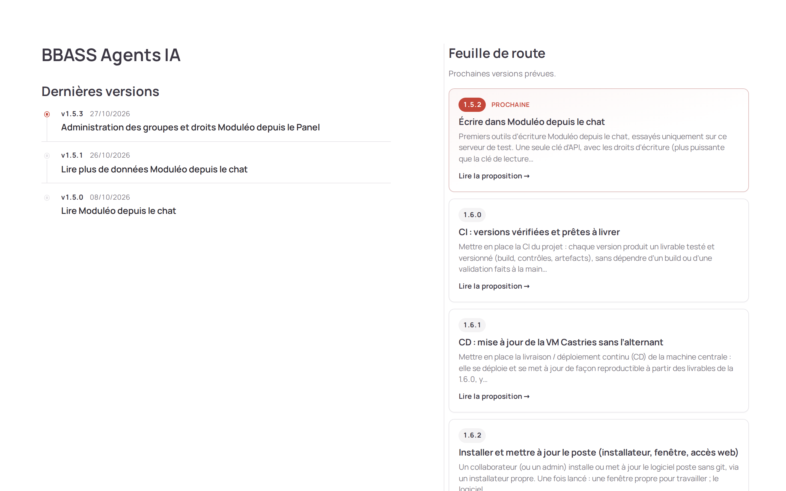
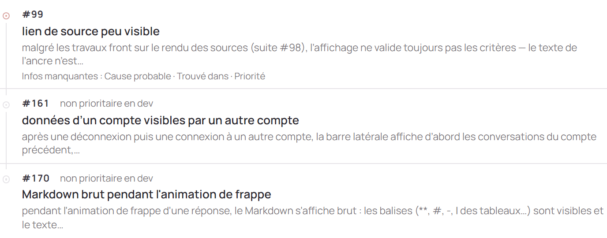
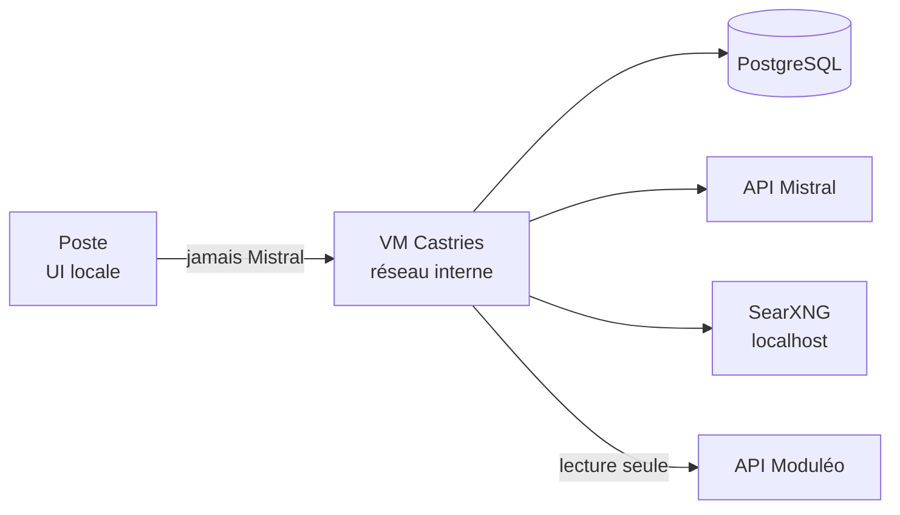
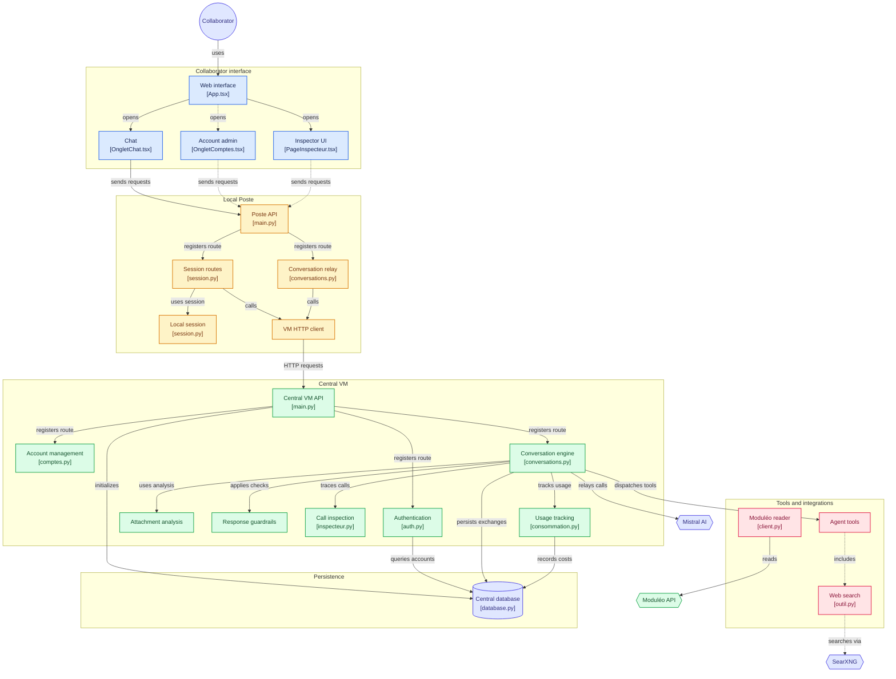
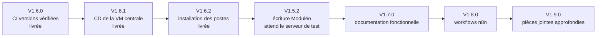
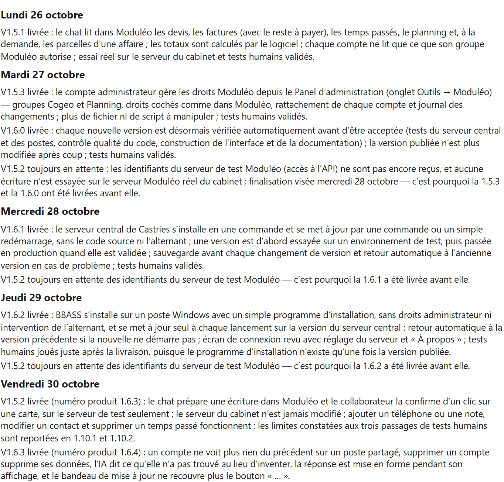

  

<!-- Compteurs publiés avec le site de doc (Deploy docs) : aucun commit de bot. -->

  
  

# Un copilote multi-agents pour le cabinet

**BBASS Agents IA** est un espace de discussion type ChatGPT, branché sur plusieurs agents métiers : ils répondent aux questions du quotidien et peuvent aussi enchaîner des actions (outils, recherches, workflows) à la place du collaborateur. Le moteur de langage est Mistral AI — choix du cabinet pour la souveraineté et la sécurité : on ne forme pas un modèle, on construit les agents et l’application qui les exploitent.

## Documentation fonctionnelle et technique

  

## État actuel

## Bugs

  

## Agents prévus

- Administration
- Appels d'offres
- Foncier
- DAO
- Urbanisme
- Détection de réseaux

## Architecture

<!-- sync:vue-systeme-mermaid -->

<!-- /sync:vue-systeme-mermaid -->

## Semaine du 26 au 30 octobre 2026

**V1.6.2 livrée** (le poste devient une application Windows : `BBASS-Setup-vX.Y.Z.exe` joint à chaque Release l’installe sans git ni droits administrateur, et chaque lancement met le poste à la version du Serveur BBASS, avec paquet signé et retour arrière ; fenêtre, zone de notification, démarrage avec Windows, écran de connexion revu avec Configuration et À propos, [ADR-0022](docs/adr/0022-poste-application-windows-version-dictee-par-la-vm.md)). Avant elle, **V1.6.1** (CD : la VM centrale livrée en images Docker sur GHCR, staging et prod, [ADR-0021](docs/adr/0021-cd-vm-centrale-staging-prod.md)), **V1.6.0** (CI : chaque version vérifiée automatiquement avant d’entrer sur `main`, [ADR-0020](docs/adr/0020-ci-argos-compartimentee.md)) et **V1.5.3** (administration des groupes et droits Moduléo depuis le Panel). **V1.5.2** (écriture Moduléo sur le serveur de test Kipaware) n’est pas encore finalisable : les identifiants du serveur de test pour l’API Moduléo ne sont pas reçus, et on ne teste pas d’écriture sur le serveur de production ; d’où la 1.5.3, la 1.6.0, la 1.6.1 et la 1.6.2 livrées avant elle. Suite sur la feuille de route : **V1.5.2** (écriture Moduléo), **V1.7.0** (documentation fonctionnelle), **V1.8.0** (workflows n8n), **V1.9.0** (pièces jointes approfondies).

### Travail réalisé

## Prérequis

- **Python 3.11** (série figée : pas 3.12 / 3.13 / 3.14).
  - Windows : dernier installeur officiel [Python 3.11.9](https://www.python.org/downloads/release/python-3119/) — prendre *Windows installer (64-bit)*. Cocher **Add python.exe to PATH**. Les correctifs 3.11.x plus récents n'ont plus d'installeur (source only).
  - macOS : `brew install python@3.11` (Homebrew), ou l'installeur officiel [Python 3.11.9](https://www.python.org/downloads/release/python-3119/) (*macOS 64-bit universal2 installer*).
- **Docker Desktop** pour le PostgreSQL local de la VM centrale ([ADR-0008](docs/adr/0008-postgresql-vm-centrale.md)) et le moteur de recherche SearXNG de l’outil `rechercher_web` ([ADR-0013](docs/adr/0013-recherche-web-searxng-auto-heberge.md) : image épinglée, `searxng/settings.yml` versionné, publié sur `http://localhost:8888` seulement). Les lanceurs le démarrent tout seuls s’il est installé mais pas lancé (attendre une à deux minutes le premier gel du moteur). Ils ne l’installent pas : Docker Desktop reste à installer une fois à la main.
- Une clé API Mistral (console [La Plateforme](https://console.mistral.ai)) pour un vrai chat

## Démarrer

Ce parcours est celui du **développement**. La VM centrale du cabinet ne s’installe plus depuis un clone : depuis la 1.6.1, elle s’installe et se met à jour à partir des images publiées à chaque Release — voir le guide admin [Installation du serveur du Copilote BBASS](docs/installation/serveur.mdx) et [Maintenance du serveur du Copilote BBASS](docs/installation/maintenance-serveur.mdx). De même, depuis la 1.6.2, un poste de collaborateur s’installe avec `BBASS-Setup-vX.Y.Z.exe` de la Release et se met à jour seul — voir [Installer et utiliser le Copilote BBASS sur son poste](docs/installation/poste-collaborateur.md) et [Environnement : Production vs Test](docs/installation/environnements.mdx).

Après avoir installé les prérequis ci-dessus (Python 3.11, Docker Desktop installé ; Docker Desktop est lancé par le lanceur s’il est arrêté), le parcours officiel est : cloner le dépôt, puis double-cliquer sur l'un des deux scripts à la racine correspondant à ton OS — aucune autre commande à taper.

**Windows** (`.bat`) :

- `lancer-vm.bat` : démarre PostgreSQL et SearXNG puis la VM centrale seule (2 fenêtres : logs Postgres, VM centrale) — utile pour développer/tester la VM seule.
- `lancer-logiciel.bat` : démarre PostgreSQL, SearXNG, la VM centrale et le poste (2 fenêtres : VM centrale, poste), puis ouvre le navigateur sur l'interface.

**macOS** (`.command`, équivalents des `.bat` ci-dessus) :

- `lancer-vm.command` : démarre PostgreSQL et SearXNG puis la VM centrale seule (2 fenêtres Terminal : logs Postgres, VM centrale).
- `lancer-logiciel.command` : démarre PostgreSQL, SearXNG, la VM centrale et le poste (2 fenêtres Terminal : VM centrale, poste), puis ouvre le navigateur sur l'interface.

  Premier lancement : si un clic droit → *Ouvrir* est nécessaire (Gatekeeper, seulement si le dépôt a été téléchargé en `.zip` plutôt que cloné avec `git clone`), ou si le double-clic ne fait rien, exécute une fois dans un Terminal (à la racine du dépôt) `chmod +x lancer-vm.command lancer-logiciel.command` puis retente le double-clic.

Les deux jeux de scripts sont autonomes : au besoin, ils installent [uv](https://docs.astral.sh/uv/) s’il manque ([ADR-0011](docs/adr/0011-gestion-dependances-python-avec-uv.md)), créent les environnements virtuels (`vm-centrale/.venv`, et `poste/.venv` pour `lancer-logiciel.*`), installent les dépendances (`uv sync`, versions figées par `uv.lock`) et créent les fichiers `.env` manquants à partir des `.env.example` correspondants (racine, `vm-centrale/`, `poste/`). Rien de manuel à faire au premier clone, ni après un `git pull` qui modifie un `pyproject.toml`/`uv.lock`. La logique commune aux deux scripts d'une même plateforme vit dans `scripts/` (`*.bat` pour Windows, `*.sh` pour macOS) afin d'éviter deux copies divergentes.

Avant le premier lancement, chiffre ta clé API Mistral : renseigne `VM_CLE_MAITRE_FICHIER` (chemin de la clé maître, hors du dépôt) dans `vm-centrale/.env`, puis, depuis `vm-centrale/`, lance `.venv/bin/python scripts/chiffrer_secret.py MISTRAL_API_KEY_CHIFFREE` (Windows : `.venv\Scripts\python`) et colle la ligne imprimée dans `.env`. Sans clé utilisable, la VM refuse de démarrer et nomme la variable en cause. `MISTRAL_API_KEY` en clair n'est plus lue ; jamais de clé dans Git. Détails : [configuration](docs/features/moduleo/configuration.mdx).

Les outils Moduléo ne sont proposés qu'aux comptes rattachés à un groupe Moduléo (1.5.1) ; être compte administrateur n'en donne aucun. Sans groupe, aucun outil Moduléo ; sans un droit (ex. factures), l'outil est absent du payload et le garde renvoie une phrase fixe. Depuis la 1.5.3, un compte administrateur rattache chaque compte à ses groupes Cogeo et Planning et à son utilisateur Moduléo (nom résolu dans Moduléo) dans le Panel (Outils → Moduléo, API `/moduleo/rattachements`), où se lit aussi le journal des droits Moduléo. Pour un poste de dev seulement, depuis `vm-centrale/` : `.venv/bin/python scripts/affecter_groupes_moduleo.py j.dupont --groupe-dev --cogeo "Tous droits (dev)" --planning "Tous droits (dev)"`. Essai réel 1.5.1 (#194) : filtres de dates en JJ/MM/AAAA (ISO ignoré), reste à payer confirmé, états de devis relevés — détail dans [`moduleo/README.md`](vm-centrale/src/vm_centrale/moduleo/README.md) et les README des outils.

Fermer les fenêtres arrête les processus correspondants (PostgreSQL et SearXNG continuent de tourner en arrière-plan tant que `docker compose down` n'a pas été lancé). La VM trouve SearXNG via `VM_CENTRALE_SEARXNG_URL` (`vm-centrale/.env`, `http://localhost:8888` par défaut) ; s'il ne répond pas, le chat fonctionne et l'IA indique que la recherche est indisponible. Les `.env` (racine, `vm-centrale/`, `poste/`) portent des identifiants/secrets locaux — ne jamais les commiter (déjà dans `.gitignore`).
